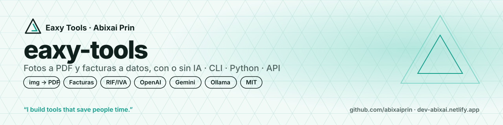
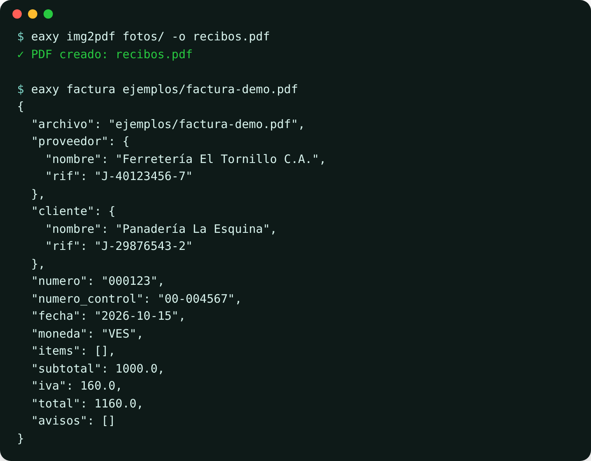

<p align="center"></p>

# eaxy-tools

**Fotos a PDF y facturas a datos, en un comando.**
Une fotos, capturas o escaneos en un solo PDF, y convierte facturas (PDF o foto) en JSON o CSV listos para tu hoja de cálculo o tu sistema. Funciona **sin IA** para PDF con texto, y **con la IA que tú elijas** (OpenAI, Gemini u Ollama local) para fotos y escaneos.

  

> 🧾 **¿Quieres el reporte del mes listo?** [Eaxy Contador VE](https://www.agensi.io/creators/abixai-prin) (skill en Agensi): carpeta de facturas venezolanas → Excel en USD con la tasa BCV de cada fecha, IVA y avisos. Funciona en Claude Code, Cursor y más de 20 agentes.
> *Need the monthly report done? Eaxy Contador VE on Agensi turns Venezuelan invoices into an Excel report in USD.*

<p align="center"></p>

## Por qué
- **Se acabó transcribir facturas a mano.** Proveedor, RIF, número, fecha, subtotal, IVA y total en segundos.
- **Pensado para Venezuela y LATAM.** Reconoce el RIF (`J-12345678-9`), montos como `Bs 1.160,00` o `1,160.00`, y fechas `dd/mm/aaaa`.
- **Te avisa cuando algo no cuadra.** Si subtotal + IVA no da el total, o falta el RIF, lo ves en `avisos`.
- **Tú decides dónde van tus datos.** Sin IA, todo queda en tu computadora. Con Ollama, la IA también corre en tu equipo. Con OpenAI o Gemini, usas **tu propia API key**.

## Instalación
```bash
pip install git+https://github.com/abixaiprin/eaxy-tools
```
Con la API HTTP: `pip install "eaxy-tools[api] @ git+https://github.com/abixaiprin/eaxy-tools"`

## Uso

**Fotos a PDF** (archivos o carpetas, en orden alfabético):
```bash
eaxy img2pdf foto1.jpg foto2.png -o recibos.pdf
eaxy img2pdf fotos/ -o recibos.pdf --pagina carta --margen 5
eaxy img2pdf capturas/ -o original.pdf --pagina original
```
Respeta la orientación de la foto del teléfono y pone las fotos horizontales en páginas horizontales.

**Facturas a datos:**
```bash
eaxy factura ejemplos/factura-demo.pdf                 # sin IA, PDF con texto
eaxy factura foto-factura.jpg --ia openai              # foto o escaneo
eaxy factura facturas/ --ia gemini --csv octubre.csv   # una carpeta entera a CSV
eaxy factura factura.pdf --ia ollama --modelo llama3.2-vision   # 100 % local
```

**Leer el texto de un PDF:** `eaxy texto contrato.pdf`

### Tu API key
Copia `.env.example` y define **una** variable en tu terminal (nunca subas tu key a GitHub):

| Proveedor | Variable | Modelo por defecto |
|---|---|---|
| OpenAI | `OPENAI_API_KEY` | `gpt-4o-mini` |
| Google Gemini | `GEMINI_API_KEY` | `gemini-2.5-flash` |
| Ollama (local) | — | `llama3.2-vision` |

`EAXY_API_KEY` y `EAXY_MODELO` sirven para cualquier proveedor. Cambia el modelo con `--modelo`.

### Como librería
```python
from eaxy.documentos import leer_factura
from eaxy.imagenes import imagenes_a_pdf

factura = leer_factura("factura.pdf")            # o ia="gemini"
print(factura.total, factura.proveedor.rif, factura.avisos)

imagenes_a_pdf(["a.jpg", "b.jpg"], "salida.pdf", pagina="a4")
```

### API HTTP
```bash
eaxy servir --puerto 8000     # docs en http://127.0.0.1:8000/docs
curl -F "archivo=@factura.pdf" http://127.0.0.1:8000/v1/factura
curl -F "imagenes=@a.jpg" -F "imagenes=@b.jpg" http://127.0.0.1:8000/v1/img2pdf -o salida.pdf
```

## Qué devuelve
```json
{
  "proveedor": { "nombre": "Ferretería El Tornillo C.A.", "rif": "J-40123456-7" },
  "cliente":   { "nombre": "Panadería La Esquina", "rif": "J-29876543-2" },
  "numero": "000123", "numero_control": "00-004567", "fecha": "2026-10-15", "moneda": "VES",
  "items": [], "subtotal": 1000.0, "iva": 160.0, "total": 1160.0, "avisos": []
}
```
> La factura de `ejemplos/` es **inventada**. Los modos con IA también llenan `items` línea por línea.

## Para equipos y empresas
- **Cierra el mes más rápido.** Procesa una carpeta de facturas y entrégale a contabilidad un CSV limpio.
- **Se integra con lo que ya usas.** Librería de Python, línea de comandos o API HTTP para tu ERP, tu sistema de cobranza o tus automatizaciones (n8n, Make).
- **Auditable y privado.** Código abierto; puedes correrlo sin IA o con IA local para que ningún documento salga de tu red.
- **¿Necesitas plantillas por proveedor, procesamiento por lotes o una integración a medida?** [Escríbeme](https://dev-abixai.netlify.app).

## Hoja de ruta
- [x] Fotos a PDF · facturas a JSON/CSV · RIF/IVA · OpenAI, Gemini y Ollama · API HTTP
- [ ] Conversión a USD con la tasa BCV del día ([tasas-ve-mcp](https://github.com/abixaiprin/tasas-ve-mcp))
- [ ] Servidor MCP: *"Claude, lee estas 30 facturas y dime cuánto IVA pagué"*
- [ ] Exportar a Excel · comprimir PDF · PDF a imágenes
- [ ] Eaxy Tools en la web, sin instalar nada

## Desarrollo
```bash
pip install -e ".[api,dev]"
pytest -q
```

## Apoya el proyecto
- ⭐ **Dale una estrella** si te ahorró tiempo.
- ☕ **[Invítame un café](https://ko-fi.com/abixaiprin)** para que sigan saliendo herramientas.
- 🔁 Compártelo con alguien que todavía transcribe facturas a mano.

## Licencia
MIT © 2026 [Abixai Prin](https://dev-abixai.netlify.app). Puedes usarlo, modificarlo y compartirlo manteniendo el aviso de derechos de autor.

---

### English
**Photos to PDF and invoices to data, in one command.** `eaxy img2pdf` merges photos or scans into a single PDF; `eaxy factura` turns invoices (PDF or photo) into JSON/CSV, without AI for text PDFs or with your own OpenAI/Gemini key or a local Ollama model. Built for Venezuelan and LATAM invoices (RIF, IVA, `1.160,00` amounts). MIT licensed.
