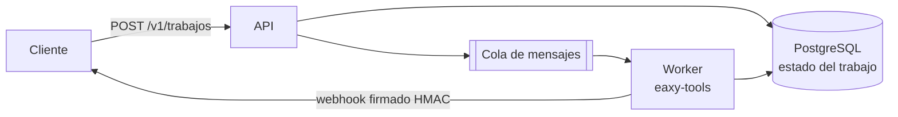

# Arquitectura

## Hoy (v0.1): local y simple
```mermaid
flowchart LR
    A[PDF o foto] --> P{¿Tiene texto?}
    P -- sí --> R[Reglas sin IA]
    P -- no / --ia --> IA[Proveedor de IA<br/>OpenAI · Gemini · Ollama]
    R --> L[Limpieza<br/>montos · RIF · fechas]
    IA --> L
    L --> V[Validación<br/>subtotal + IVA = total]
    V --> S[JSON · CSV · API]
```

| Módulo | Qué hace |
|---|---|
| `imagenes.py` | Fotos a PDF (orientación, transparencias, A4/carta/original) |
| `texto.py` | Texto e imágenes incrustadas de un PDF |
| `factura.py` | Esquema, limpieza, validación y extracción por reglas |
| `proveedores.py` | Interfaz `Proveedor` y conectores (agregar uno = una clase) |
| `documentos.py` | Une todo: archivo → `Factura` validada |
| `cli.py` / `api.py` | Línea de comandos y API HTTP (FastAPI) |

## Siguiente: versión en la nube
Para volumen alto el flujo se vuelve asíncrono, así la API responde al instante y nada se pierde si un proveedor de IA se cae:


- Archivos en almacenamiento de objetos, con borrado automático.
- Reintentos con espera creciente y límite de uso por cliente.
- Métricas de costo por documento (tokens) para cobrar de forma justa.
